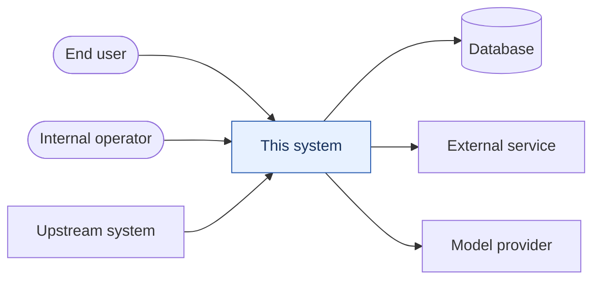
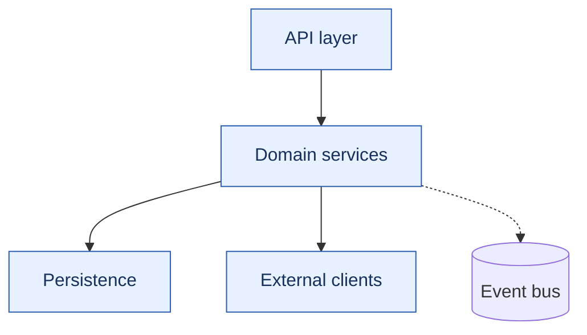

# Architecture

<!-- PROJECT-OWNED. The framework never overwrites this file. -->

**Structure, not behaviour.** What the pieces are, how they fit, and what
crosses between them. For *what the system does*, read `capabilities/`. For
*why it is built this way*, read `adr/`. Keeping those three separate is what
stops them drifting into three stale copies of each other.

Aim for two pages. If a section needs more, it is probably a capability
document or an ADR.

---

## System context

Who and what this system talks to.

<!-- PROJECT: replace with your actual context. Keep it to one level —
     this is the view from outside, not the internals. -->

## Components

| Component | Responsibility | Owns data? | Capabilities it serves |
|---|---|---|---|
| | | | |

One row per deployable or major module. The last column is the link into
`capabilities/` — if a component serves none, ask why it exists; if a
capability has no component, it may be undocumented.

## Internal structure

<!-- PROJECT: replace. Show the layers or services and what may call what.
     Arrows that are NOT allowed are often more informative than those that
     are — note them below. -->

**Not allowed:** <!-- e.g. the API layer never touches the repository directly -->

## Data

| Store | Technology | What lives there | Owner |
|---|---|---|---|

Migrations, retention, and anything with a compliance constraint.

## Integration points

| Direction | System | Protocol | Failure behaviour | Contract |
|---|---|---|---|---|
| outbound | | HTTP / event / queue | timeout, retry, fallback | link |
| inbound | | | | |

"Failure behaviour" is the column people skip and later need.

## Cross-cutting concerns

| Concern | Approach | Where it lives |
|---|---|---|
| Authentication / authorisation | | |
| Configuration and secrets | | |
| Logging and correlation | | |
| Metrics and alerting | | |
| Error handling and retries | | |
| Idempotency | | |
| Rate limiting | | |
| Caching | | |

## Model and prompt architecture

*(LLM-based systems only — delete otherwise)*

| Aspect | Approach |
|---|---|
| Provider and models | |
| Where prompts live | |
| Tool / function surface | |
| Context assembly | |
| Output validation | |
| Guardrails | |
| Fallback when the model fails | |
| Cost and latency budget | |

Prompts are code (constitution rule 18): versioned, reviewed, changed through
the normal flow, and covered by evals.

## Environments and deployment

| Environment | Purpose | Topology | Data |
|---|---|---|---|

How a change reaches production, and how it is rolled back.

## Scale and limits

Current volumes, known ceilings, and what breaks first under load. Honest
numbers, or "unmeasured" — a guess recorded as fact is worse than a gap.

## Key decisions

Decisions that shaped this architecture. One line each, linking to the ADR.

| Decision | ADR |
|---|---|
| *e.g. Outbox pattern for event publishing* | `adr/0008-...` |

## Known debt

What you would do differently, what it costs today, and what it would take to
change. Writing it down is what stops it being rediscovered every six months.

| Debt | Impact | Rough cost to fix |
|---|---|---|

---

## Keeping this true

This document is structural, so it changes less often than capabilities — but
it still drifts. Update it when a change adds or removes a component, alters an
integration point, or changes a cross-cutting approach, and set
`last-verified`. The `drift-check` skill covers it alongside capabilities.

If you find yourself describing *behaviour* here, it belongs in a capability
document instead.
