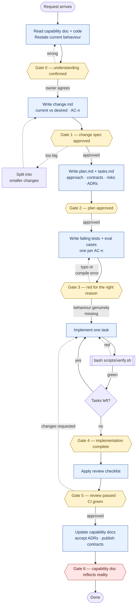
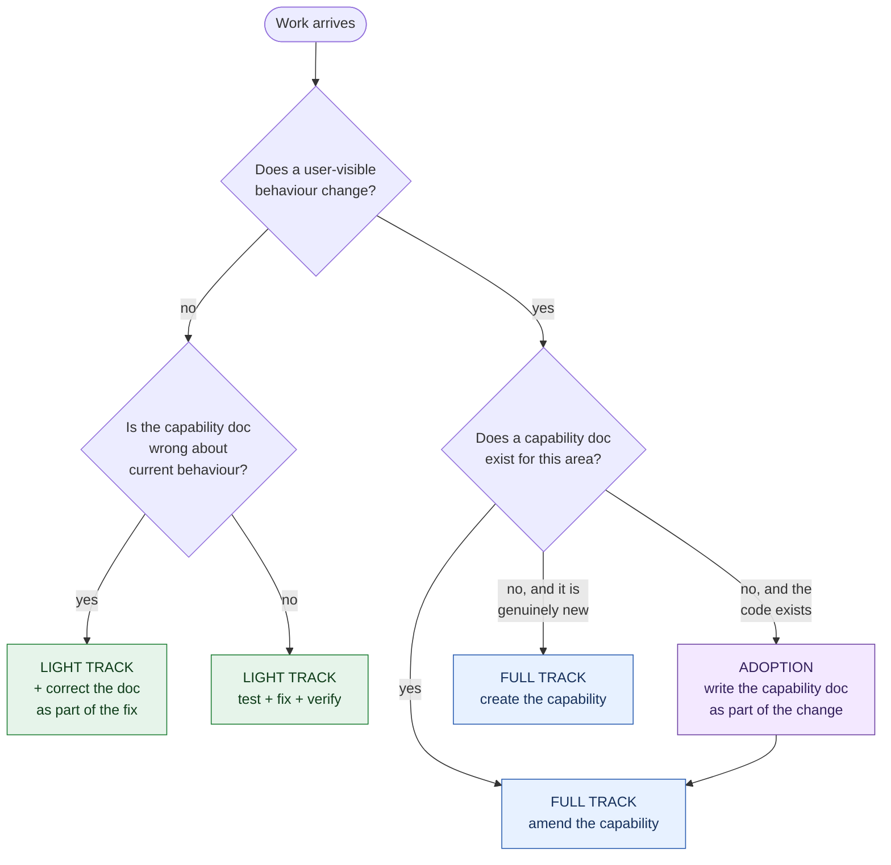
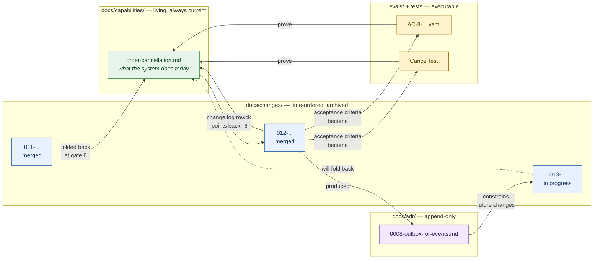
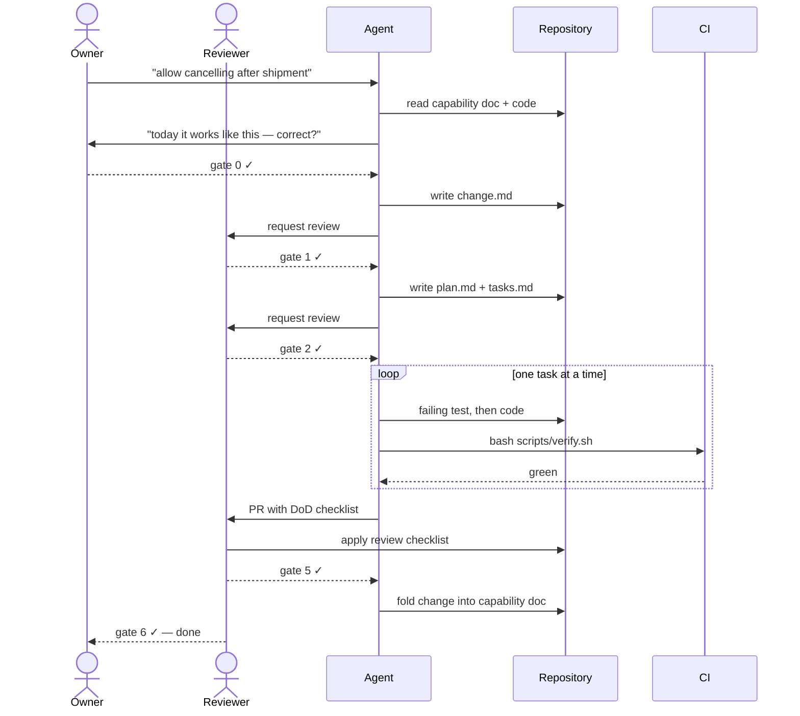
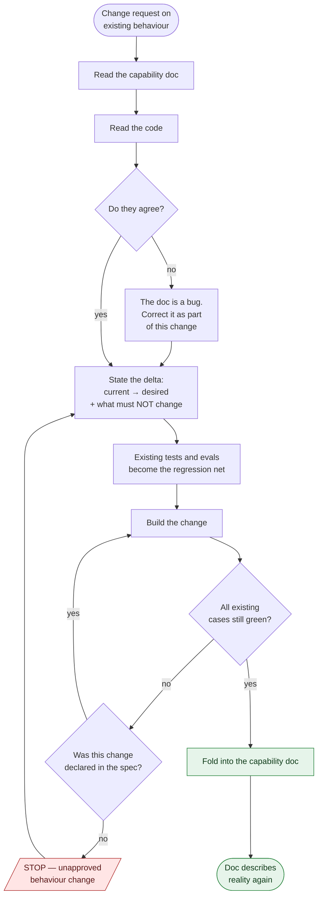
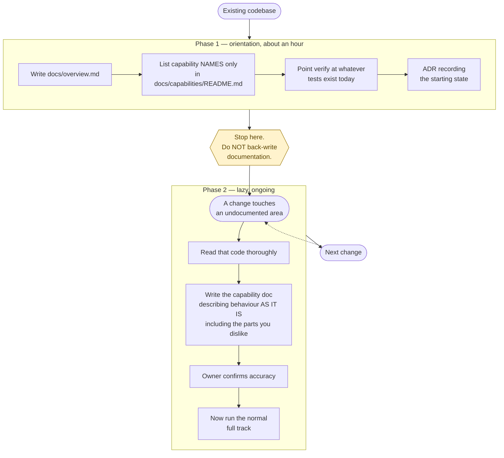
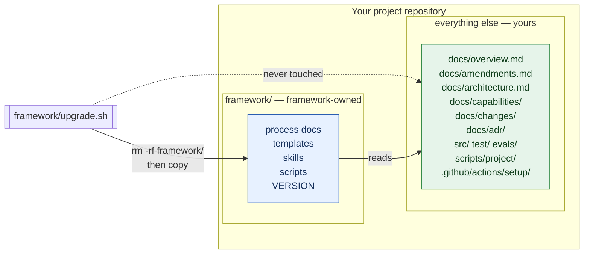

# Workflows

**FRAMEWORK-OWNED — do not edit.**
**HUMAN-FACING — agents should not read this file.** A flowchart's meaning
sits in an edge list that has to be traversed; for an agent the same facts are
faster and less ambiguous as the ordered steps in
[working-guide.md](working-guide.md) and the criteria in
[definition-of-done.md](definition-of-done.md). Diagrams are here because
people read structure better as a picture.

The same process, drawn. Mermaid, so it is plain text, diffable, and rendered
by GitHub and most IDEs.

**Nothing here is normative.** These diagrams show *flow* and gate *names*
only — no exit criteria, which live in `definition-of-done.md` alone. Where a
diagram and that file disagree, that file wins.

The gates, by name:

<!-- BEGIN GENERATED: gates-names — from definition-of-done.md, do not edit by hand -->

- **Gate 0** — Understanding confirmed
- **Gate 1** — Change spec approved
- **Gate 2** — Plan approved
- **Gate 3** — Tests red for the right reason
- **Gate 4** — Implementation complete
- **Gate 5** — Review passed
- **Gate 6** — Change folded back (Definition of Done)

*Generated from [definition-of-done.md](definition-of-done.md), the single source of truth for the gate model.*

<!-- END GENERATED -->

---

## 1. The full track

New or altered behaviour. Every arrow out of a gate needs a human.

Gate 6 is marked differently on purpose. It is the one that gets skipped, and
skipping it turns every capability document into fiction.

---

## 2. Which track?

The owner chooses. The cost of the full track on a small change is an hour; the
cost of the light track on a real behaviour change is an undocumented system.

---

## 3. How the artifacts relate

Four nouns, four questions:

| Artifact | Answers | Lifecycle |
|---|---|---|
| Capability | What does it do **now**? | Living — amended forever |
| Change | What changed, and why? | Archived once merged |
| ADR | Why this approach over the alternatives? | Append-only; superseded, never edited |
| Test / eval | Does it actually do it? | Runs on every commit |

---

## 4. Who does what

The agent is always the **author**, never the reviewer of its own work. A
separate agent session with fresh context makes a reasonable second reviewer —
it has not talked itself into the approach — but never the final one.

---

## 5. Brownfield: the fold-back loop

What makes this framework work on code that already exists.

---

## 6. Adoption: an existing codebase

Documenting everything up front is weeks of work producing documents nobody
reads, drifting from the day they are written. After a few months of lazy
adoption the areas you actually work on are documented, and the dormant ones
cost you nothing.

---

## 7. Ownership and upgrade

Where the framework needs project-specific content it **reads a file you own**
rather than containing it:

| Framework file | Reads your |
|---|---|
| `framework/constitution.md` | `docs/amendments.md` |
| `framework/craft.py` | `scripts/project/verify-impl.sh` |
| generated CI workflow | `.github/actions/setup/action.yml` |
| `AGENTS.md` | `docs/overview.md` |

`verify` warns when a framework-owned file has been edited locally, and names
the project-owned file the content belonged in.
